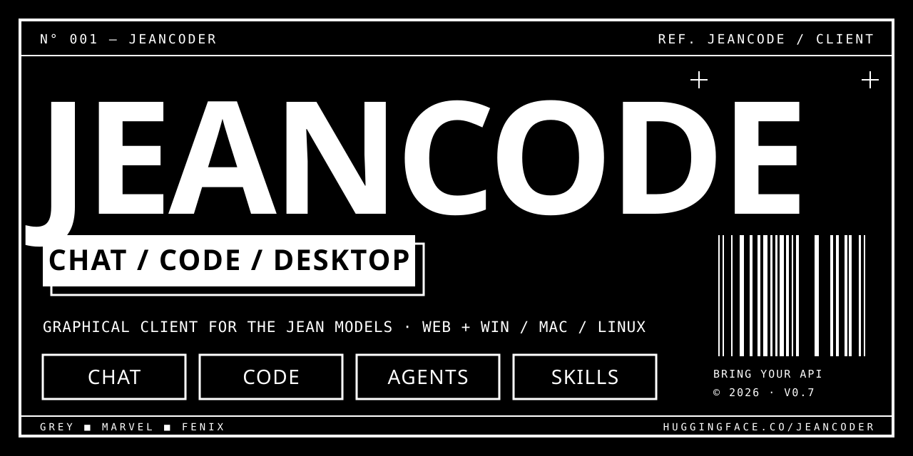
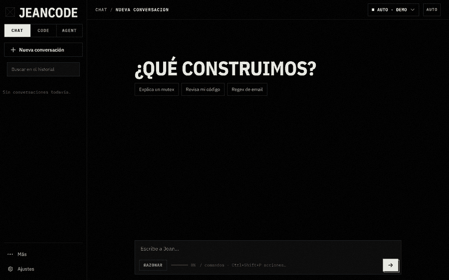
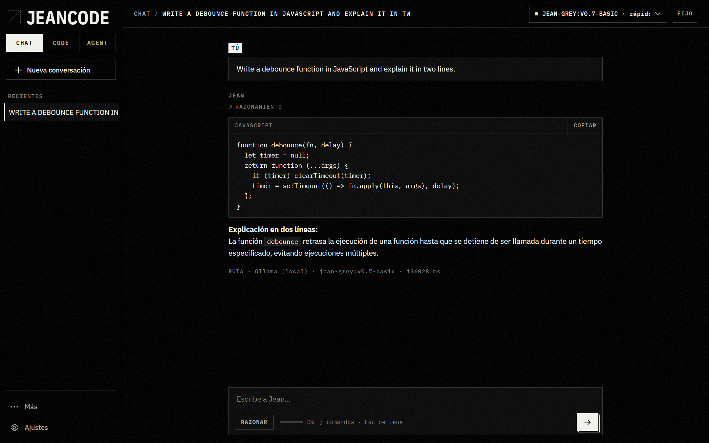

<div align="center">



<br>

# JeanCode — el agente de programación con IA, abierto, que trae su propio modelo

**Chatea · genera proyectos completos · usa un agente que edita código, ejecuta comandos, revisa sus propios errores y puede manejar tu PC.**<br>
Cualquier modelo compatible con OpenAI: **Ollama, llama.cpp, LM Studio, OpenRouter, NVIDIA NIM, Groq, DeepSeek** y 28 proveedores en la nube — o tu propia API Jean **gratis** en las GPU gratuitas de Kaggle.

[](https://jeancodeeer.github.io/JeanCode/)
[](https://github.com/jeancodeeer/JeanCode/releases/latest)
[](https://github.com/jeancodeeer/Jean-API-Generator)
[](https://huggingface.co/JeanCoder/jean-models)

[`ENGLISH`](README.md) · **`ESPAÑOL`**

</div>

```
N° 001 — JEANCODE                                                     REF. 1.x
Sin servidor, sin cuenta, sin telemetría. Tu modelo, tus claves, tu máquina.
```

<p align="center">
  
  <br><sub>10 segundos por la app de escritorio real: respuesta, <b>Regenerar → más corta</b> con versiones ‹ 2/2 ›, paleta de comandos, apps MCP y skills. Las respuestas salen de un modelo de demostración para que el vídeo sea reproducible.</sub>
</p>

<p align="center">
  
  <br><sub>Y una respuesta real de Jean Grey ejecutándose en local con Ollama (CPU, sin nube).</sub>
</p>

<br>

## 01 — POR QUÉ JEANCODE

- **Usa el modelo que quieras.** 28 proveedores en la nube ya configurados (OpenAI, Anthropic, Gemini, OpenRouter, Groq, NVIDIA NIM, DeepSeek, Mistral, xAI, Together, Fireworks, Cerebras, SambaNova, DeepInfra, Moonshot/Kimi, Z.ai/GLM, Qwen, MiniMax, Cohere y más) y además **Ollama, LM Studio, LiteLLM, llama.cpp, vLLM, Jan y KoboldCpp** en tu propia PC. Cambia de modelo a mitad de conversación.
- **Un camino gratis que funciona.** Conéctalo a [Jean-API-Generator](https://github.com/jeancodeeer/Jean-API-Generator) y tienes tu propia API compatible con OpenAI en tu cuenta gratuita de Kaggle, con GPU: sin tarjeta y sin cuotas nuestras.
- **Un agente de verdad, no una caja de chat.** Lee, busca y edita tus archivos, ejecuta comandos con tu permiso, lanza subagentes en paralelo, carga skills, mantiene una lista de tareas y **vuelve atrás** archivos y conversación a cualquier mensaje.
- **Revisa su propio trabajo.** Tras cada edición recibe los errores de sintaxis del archivo (JS, JSON, Python, PowerShell, Bash, Go) y los corrige antes de seguir, como un LSP, sin ejecutar nada de tu repositorio.
- **Se conecta con tus apps.** Gmail, Drive, Calendar, Docs, Sheets, GitHub, Notion, Linear, Jira, Figma, Supabase y 30 más mediante **MCP**, el mismo estándar que usa Claude Code: un clic y autorizas en el navegador; cada acción pide permiso. [Cómo funciona](docs/apps.md).
- **100 skills y automatizaciones como en Claude Code.** Catálogo de 100 skills abiertas con un clic (Office, TDD, depuración, React, Python, seguridad, Hugging Face…), hooks que bloquean o aprueban acciones, tareas programadas y `/loop`. [Automatizaciones](docs/automations.md).
- **Puede usar tu computadora** (Windows). Ve la pantalla, lee los controles de las ventanas, hace clic, escribe y pulsa atajos, con permisos por nivel de riesgo, una barra flotante para DETENER y parada de emergencia con `Ctrl+Alt+Q`.
- **Nada oculto.** `/context` muestra el prompt exacto que recibe el modelo y cuántos tokens ocupa cada parte. `/doctor` revisa toda tu configuración de una vez.

<br>

## 01b — DÓNDE ENCAJA Y DÓNDE NO

Ya hay agentes de programación excelentes ([OpenCode](https://github.com/sst/opencode), [Cline](https://github.com/cline/cline), [Claude Code](https://github.com/anthropics/claude-code), [Aider](https://github.com/Aider-AI/aider)). Viven en una terminal o dentro de un editor. JeanCode es el que tiene **ventana propia y ningún servidor en el medio**, y por eso parte de otra pregunta: *¿y si la IA con la que programas respondiera solo ante ti?*

| SI NECESITAS… | JEANCODE |
|---|---|
| que tus claves y tu código no pasen por servidores ajenos | No hay backend ni telemetría. Las claves van en el llavero del sistema. Un aviso te frena antes de pegar un secreto a un modelo remoto. |
| usar el modelo que sea más barato o mejor esta semana | 28 proveedores, Ollama, LM Studio y llama.cpp en un solo selector; cambias a mitad de conversación; respaldo automático si uno falla. |
| una sola herramienta en tu laptop, tu celular y una PC prestada | Escritorio (Windows, macOS, Linux), web instalable y apps de Android/iOS comparten interfaz e historial. |
| ver qué se le envía de verdad al modelo | `/context` imprime el prompt exacto y cuánto pesa cada parte en tokens. |
| deshacer a un agente que se pasó | **Volver aquí** restaura archivos *y* conversación a cualquier mensaje. |
| una IA que te diga cuándo no sabe | Se le indica no inventar fuentes, los enlaces se pueden verificar a demanda y cada respuesta dice qué modelo la escribió. |

**Límites, sin adornos**
- El **Agent** y el control de la PC necesitan la app de escritorio; el control de la PC es **solo Windows** y rinde mejor con un modelo potente (un modelo local pequeño puede perder el hilo en tareas largas de pantalla).
- La app de Android va firmada con clave de depuración y la de iOS **sin firmar** (se instala con AltStore o Sideloadly).
- La [API Jean](https://github.com/jeancodeeer/Jean-API-Generator) gratuita corre en las GPU T4 gratuitas de tu cuenta de Kaggle (unas 30 horas a la semana, renovadas cada semana); una sesión dura hasta 12 horas y da una URL nueva cada vez. Es un servidor personal, no un servicio alojado. Para trabajo pesado conecta cualquier otra API.
- Las comparaciones de arriba hablan de dónde vive cada herramienta, no de cuál escribe mejor código: eso depende del modelo que conectes.

## 02 — EMPIEZA EN UN MINUTO

| TIENES | HAZ ESTO |
|---|---|
| **Ollama / LM Studio** en tu PC | Instala la [app de escritorio](https://github.com/jeancodeeer/JeanCode/releases/latest) → **Usar los modelos de esta PC**. Un clic, sin claves. |
| **Una clave de API** (OpenRouter, Groq, NVIDIA…) | Abre [JeanCode web](https://jeancodeeer.github.io/JeanCode/) → elige el proveedor → pega la clave. La URL se completa sola. |
| **Nada todavía** | Crea tu API gratis con [Jean-API-Generator](https://github.com/jeancodeeer/Jean-API-Generator) (abres el notebook en tu Kaggle y pulsas Run All, ~5 min) y pegas la URL que imprime. |

| PLATAFORMA | CÓMO CONSEGUIRLA | MODOS |
|---|---|---|
| **Web** (cualquier móvil o computadora) | [jeancodeeer.github.io/JeanCode](https://jeancodeeer.github.io/JeanCode/): PWA instalable que funciona sin conexión | CHAT · CODE |
| **Android** | `JeanCode-x.y.z-android.apk` de la [última release](https://github.com/jeancodeeer/JeanCode/releases/latest) | CHAT · CODE |
| **iOS / iPadOS** | `JeanCode-x.y.z-ios-unsigned.ipa`: se instala con [AltStore](https://altstore.io) o [Sideloadly](https://sideloadly.io) usando tu propio Apple ID | CHAT · CODE |
| **Windows · macOS · Linux** | `.exe` · `.dmg` · `.AppImage` de la [última release](https://github.com/jeancodeeer/JeanCode/releases/latest) | CHAT · CODE · **AGENT** · control del equipo |
| **Python + pygame** (cualquier sistema, y PyKernel) | `JeanCode-x.y.z-pygame.zip` de la [última release](https://github.com/jeancodeeer/JeanCode/releases/latest) → `pip install pygame-ce` → `python jeancode_pygame.py`. Ver [pygame/README.md](pygame/README.md) | CHAT |

Las apps del móvil son la misma web compilada con Capacitor. El APK de Android va firmado con una clave de depuración (permite «instalar apps desconocidas»); la de iOS va sin firmar porque publicar en la App Store exige una cuenta de desarrollador de Apple de pago.

<br>

## 02b — CÓMO SE INSTALA EN CADA DISPOSITIVO

Todo se descarga de la [última release](https://github.com/jeancodeeer/JeanCode/releases/latest) (`x.y.z` es la versión). Ninguna versión pide cuenta: solo la URL y la clave de tu API.

<details open>
<summary><b>Web (cualquier navegador)</b></summary>

Abre [jeancodeeer.github.io/JeanCode](https://jeancodeeer.github.io/JeanCode/). No hay nada que instalar. Para tenerla como app (funciona sin conexión):
- **Chrome / Edge en PC o Android**: menú ⋮ → **Instalar JeanCode** (o el icono de instalar en la barra de direcciones).
- **Safari en iPhone / iPad**: botón Compartir → **Añadir a pantalla de inicio**.

Sin internet también puedes usar `JeanCode-x.y.z-web.zip`: descomprímelo y sírvelo con `python -m http.server 8000` dentro de la carpeta.
</details>

<details>
<summary><b>Android</b></summary>

1. Descarga `JeanCode-x.y.z-android.apk` desde el móvil.
2. Ábrelo. Android pedirá permiso para **instalar apps desconocidas** desde el navegador o el gestor de archivos: concédelo solo para esa app.
3. Pulsa **Instalar**. Para actualizar, instala el APK nuevo encima (se conservan tus datos).

Va firmado con una clave de depuración, por eso Play Protect puede avisar; la app es la misma web compilada con Capacitor.
</details>

<details>
<summary><b>iPhone / iPad</b></summary>

El archivo `JeanCode-x.y.z-ios-unsigned.ipa` va sin firmar (publicar en la App Store exige una cuenta de pago de Apple). Se instala con tu propio Apple ID:
1. Instala [AltStore](https://altstore.io) o [Sideloadly](https://sideloadly.io) en tu PC o Mac y conecta el iPhone.
2. Arrastra el `.ipa` y entra con tu Apple ID.
3. En el iPhone: **Ajustes → General → VPN y gestión de dispositivos** → confía en tu Apple ID. En iOS 16 o superior, activa también **Modo de desarrollador** (Ajustes → Privacidad y seguridad).

Con un Apple ID gratis la app caduca a los 7 días: vuelve a instalarla (AltStore la renueva solo). ¿Prefieres no hacer esto? Usa la web desde Safari.
</details>

<details>
<summary><b>Windows</b></summary>

1. Descarga `JeanCode-x.y.z-win-x64.exe` y ábrelo.
2. Si SmartScreen dice «Windows protegió su PC» (el instalador no lleva firma de pago): **Más información → Ejecutar de todas formas**.
3. Elige la carpeta y termina. Aparece en el menú Inicio. Las versiones nuevas se instalan encima.
</details>

<details>
<summary><b>macOS</b></summary>

1. Descarga el `.dmg` de tu Mac: `mac-arm64` para Apple Silicon (M1, M2…), `mac-x64` para Intel.
2. Ábrelo y arrastra **JeanCode** a **Aplicaciones**.
3. La primera vez macOS lo bloquea porque no está notarizado: clic derecho sobre JeanCode → **Abrir** → **Abrir**. Si no aparece la opción: **Ajustes del Sistema → Privacidad y seguridad → Abrir igualmente**, o en Terminal `xattr -dr com.apple.quarantine /Applications/JeanCode.app`.
</details>

<details>
<summary><b>Linux</b></summary>

```bash
chmod +x JeanCode-x.y.z-linux-x86_64.AppImage
./JeanCode-x.y.z-linux-x86_64.AppImage
```
Si se queja de FUSE: `sudo apt install libfuse2` (en Ubuntu 24.04+ es `libfuse2t64`).
</details>

<details>
<summary><b>Python + pygame (cualquier sistema con Python 3.8+)</b></summary>

Un cliente de chat ligero en una ventana: ideal para PCs viejas, Raspberry Pi o una terminal sin navegador.
```bash
pip install pygame-ce
python jeancode_pygame.py          # dentro de la carpeta de JeanCode-x.y.z-pygame.zip
```
F2 API y clave · F3 modelo · F4 historial · Esc detiene · Ctrl+Q sale. Más en [pygame/README.md](pygame/README.md).
</details>

<details>
<summary><b>PyKernel</b></summary>

[PyKernel](pygame/README.md#dentro-de-pykernel) es un kernel x86_64 cuyo sistema operativo es Python (MicroPython): arranca directo en `>>>`. El cliente de pygame corre dentro sin cambios.

**Si tu PyKernel ya lo trae** (`/lib/jeancode`):
```bash
python tools/run.py --screen        # en el PC: abre la máquina en una ventana y el puente de red
```
```
>>> jeancode
```

**Si no lo trae**, cópialo a su disco (FAT) con mtools, en Linux o WSL, con la máquina apagada:
```bash
unzip JeanCode-x.y.z-pygame.zip
mmd   -i build/disk.img ::/lib                                   # si /lib aún no existe en el disco
mcopy -i build/disk.img -s JeanCode-x.y.z-pygame/jeancode ::/lib/
```
Los módulos de `/disk/lib` se importan solos. Dentro de PyKernel:
```
>>> from jeancode import app; app.main()
```

**La red:** PyKernel todavía no tiene tarjeta de red ni TCP/IP. JeanCode envía cada petición por el **segundo puerto serie (COM2)** y `bridge.py`, en el PC anfitrión, hace la conexión HTTPS. `tools/run.py` lo prepara solo; con QEMU a mano:
```bash
qemu-system-x86_64 ... -serial vc -serial tcp:127.0.0.1:4555,server=on,wait=off
python bridge.py --connect 127.0.0.1:4555                        # en otra terminal
```
Para ver la ventana, QEMU necesita una pantalla gráfica (en WSL: `sudo apt install qemu-system-gui`). Ajustes e historial quedan en `/disk/jeancode/`. Dentro de PyKernel, `localhost` es el PC donde corre el puente (sirve para Ollama o LM Studio).
</details>

<br>

## 03 — TRES MODOS

<table>
<tr>
<td width="33%" valign="top"><b>CHAT</b> · web + escritorio<br>Markdown en streaming, bloques de código, razonamiento plegable y consumo de tokens por respuesta.</td>
<td width="33%" valign="top"><b>CODE</b> · web + escritorio<br>Describes un proyecto y se escriben todos los archivos. Árbol, vista previa en vivo y descarga en <code>.zip</code>. Nada se ejecuta en tu PC.</td>
<td width="33%" valign="top"><b>AGENT</b> · escritorio<br>Un agente al estilo de Claude Code y OpenCode, dentro de la carpeta que elijas.</td>
</tr>
</table>

<br>

## 04 — EL AGENTE

| | |
|---|---|
| **Herramientas** | `list_dir` · `glob` · `read_file` · `search` · `diagnostics` · `webfetch` · `write_file` · `edit_file` · `move_file` · `delete_file` (a la papelera) · `run_command` · `start_process` / `process_output` / `stop_process` (servidores de desarrollo) · `todo_write` · `spawn_subagent` · `load_skill` |
| **BUILD / PLAN** | `BUILD` implementa; `PLAN` solo investiga y propone. `Tab` alterna. Tras un plan: **Aprobar y ejecutar en BUILD**. |
| **Permisos** | `PREGUNTAR TODO` · `EDITAR SIN PREGUNTAR` · `SOLO LECTURA`. Cada edición muestra antes el diff. **Permitir siempre aquí** por carpeta y comando exacto; los comandos destructivos preguntan siempre igualmente. |
| **Volver atrás** | **Volver aquí** en cada mensaje. En carpetas git el punto de control cubre todo el árbol, así que también vuelven los archivos que cambió un comando. |
| **Autorrevisión** | Diagnóstico de sintaxis tras cada escritura. `diagnostics` con `deep` añade TypeScript, ESLint y `tsc` del propio proyecto, con tu permiso, porque eso ejecuta código del repositorio. |
| **Subagentes** | Varios `spawn_subagent` corren en paralelo con su propio contexto; cada uno informa pasos, herramientas, errores, tokens y tiempo. Subagentes del proyecto en `.jeancode/agents/*.md`. |
| **Skills** | Carpetas con un `SKILL.md`. Se instalan desde una carpeta, un repo git o una URL. Ver [`skills/`](skills/). |
| **Memoria del proyecto** | `AGENTS.md`, `JEANCODE.md` o `CLAUDE.md` se cargan en cada sesión; `/init` crea uno. Las **reglas fijadas** sobreviven a la compactación. |
| **Hooks** | `.jeancode/hooks.json` (`post_edit`, `post_turn`), con confianza pedida una vez por cada cambio. |
| **Contexto** | El medidor usa la ventana **real** del modelo (la informa el proveedor, el router o llama-server). Al 85 % pregunta antes de compactar y muestra el resumen. |

**Comandos:** `/new` `/clear` `/compact` `/context` `/doctor` `/model <id>` `/export` `/help` · CODE: `/zip` · AGENT: `/init` `/plan` `/build` `/undo` `/review` · y los tuyos en `.jeancode/commands/<nombre>.md`.
**Teclas:** `Esc` detener · `Ctrl+K` nueva · `Ctrl+1/2/3` modo · `Tab` BUILD↔PLAN · `@` adjuntar archivo.

<br>

## 05 — CONTROL DEL EQUIPO (WINDOWS)

Actívalo en **Ajustes → Equipo** y el agente podrá manejar tu escritorio: captura de pantalla, lectura de los controles de cualquier ventana (UI Automation, así funciona incluso con modelos sin visión), mover y hacer clic, arrastrar, desplazar, escribir, pulsar atajos, cambiar de ventana y abrir aplicaciones, en un ciclo observar → actuar → verificar.

| RIESGO | EJEMPLOS | POR DEFECTO |
|---|---|---|
| **Bajo** | leer la pantalla, clic, escribir en una app normal | permitido |
| **Medio** | atajos, abrir aplicaciones, texto con Enter | se pregunta una vez por acción exacta |
| **Alto** | cualquier cosa en una terminal, abrir shells, `Win` / `Alt+F4` | **se pregunta siempre** |

Nunca escribe en campos de contraseña ni actúa sobre la ventana de JeanCode, registra cada acción sin el texto tecleado y se detiene al instante desde la barra flotante o con `Ctrl+Alt+Q`. Detalles y límites reales (ventanas de administrador, UAC, solo el monitor principal) en [docs/computer-control.md](docs/computer-control.md). macOS y Linux: todavía no.

<br>

## 06 — QUÉ HACE DISTINTO

Construido a partir de las quejas más comunes sobre Claude Code y OpenCode (issues, foros y reseñas):

| PROBLEMA EN OTROS | JEANCODE |
|---|---|
| Atado a los modelos de un solo proveedor | 28 proveedores en la nube + servidores locales + tu propia API gratis; cambias a mitad de sesión. |
| La compactación es opaca y pierde instrucciones | Nunca en silencio: pregunta al 85 % y muestra el resumen; reglas fijadas y memoria del proyecto van en cada turno. |
| El medidor supone una sola ventana | Usa la ventana real de cada modelo; `/compact` ajusta el resumen a ella. |
| Coste impredecible | Tokens bajo cada respuesta, total de la sesión y coste cuando el proveedor publica precios. |
| «¿Qué le está enviando de verdad?» | `/context` imprime el prompt exacto y el peso de cada parte. |
| Errores de configuración sin causa clara | `/doctor` revisa conexiones, modelo, ventana, carpeta, memoria, hooks y skills, con el arreglo de cada fallo. |
| Puntos de control que no cubren la terminal, o ninguno | **Volver aquí** restaura archivos *y* conversación; en git, todo el árbol de trabajo. |
| Fatiga de permisos | Permitir siempre por carpeta y comando exacto, editable; los destructivos siguen preguntando. |
| Sin respuesta de un LSP | Diagnóstico de sintaxis tras cada edición y revisión profunda a demanda. |
| Subagentes opacos | Traza por subagente: pasos, herramientas, errores, tokens y tiempo. |
| Interfaz cargada de un CDN, telemetría | Todo viene con la app. Sin analítica, sin backend, sin peticiones a Google. |

<br>

## 07 — CÓMO SE CONECTA

```
┌──────────────┐   tu URL + tu clave    ┌──────────────────────────────────────┐
│  JEANCODE    │ ─────────────────────▶ │ Ollama · LM Studio · llama.cpp       │
│  web / app   │ ◀───── streaming ───── │ OpenRouter · NVIDIA NIM · Groq · …   │
└──────────────┘                         │ o TU Jean-API-Generator (gratis)     │
                                         └──────────────────────────────────────┘
```

Cada conexión se valida antes de usarla (URL mal escrita, http desde una página https, clave en la URL, duplicados, proveedor que no corresponde a ese host: se corrige solo). **AUTO** elige un modelo por modo y salta las conexiones caídas; tú decides qué pasa cuando un modelo falla (mostrar el error, el mismo modelo por otra conexión o cualquier otro modelo). Cada respuesta lleva su ruta, sin claves. **Hugging Face**, en el menú lateral, carga cualquier GGUF del Hub en tu Codespace con barra de progreso.

**APIs que bloquean el navegador (CORS).** Algunos proveedores (NVIDIA NIM, SambaNova, Z.ai) rechazan las llamadas desde páginas web (comprobado en vivo el 2026-11-14). JeanCode lo resuelve sin servidores de terceros: en la web envía esas llamadas por el **relay de tu propio Jean-API-Generator** (`/relay/` en su router, con streaming, solo hacia una lista fija de proveedores conocidos); en las apps del móvil, si no hay relay, usa la red nativa del teléfono. Un proveedor desconocido que falla desde el navegador se detecta y se recuerda. En el escritorio no hace falta nada de esto.

El repositorio **no contiene URLs ni claves**. En el navegador se guardan en el almacenamiento local; en el escritorio la clave se cifra con el llavero del sistema.

<br>

## 08 — DESDE EL CÓDIGO

```bash
python -m http.server 8000 --directory web        # web: cualquier servidor estático
cd desktop && npm install && npm start            # escritorio (Electron)
node --test tests/unit.test.mjs                   # pruebas unitarias
python pygame/jeancode_pygame.py                  # cliente pygame (pip install pygame-ce)
python -m unittest discover -s pygame/tests       # sus pruebas
node --test --test-concurrency=1 tests/computer/control.test.mjs   # pruebas reales de control del equipo (Windows)
```

```
web/        HTML/CSS/módulos ES sin paso de build (GitHub Pages + PWA)
mobile/     web/ empaquetada con Capacitor para iOS y Android (cd mobile && npm install && npm run android|ios)
desktop/    Electron; usa web/ como interfaz · lib/ = archivos, terminal, diagnósticos, control del equipo
pygame/     cliente en Python + pygame: el mismo código en CPython y en PyKernel (MicroPython)
skills/     skills de ejemplo     docs/     control del equipo, capturas
```

Publicar: `node scripts/version.mjs X.Y.Z` y la etiqueta `vX.Y.Z`. GitHub Actions compila los instaladores de Windows, macOS (Intel + Apple Silicon) y Linux y el `.zip` de la web. Historial: [CHANGELOG.md](CHANGELOG.md).

<br>

## 09 — PRIVACIDAD · SEGURIDAD

Sin backend, sin base de datos, sin analítica. Los mensajes van directo de tu equipo a la API que elegiste. El agente trabaja solo dentro de la carpeta que elijas (`..` y los enlaces que escapan se rechazan), el texto que lee de la pantalla se limpia de claves y tokens antes de llegar a un modelo, y nunca ejecuta las herramientas de tu repositorio sin preguntar. Reporta problemas: [SECURITY.md](SECURITY.md).

<br>

## 10 — LICENCIA

[MIT](LICENSE). Úsalo, modifícalo y distribúyelo, también en proyectos comerciales; solo conserva el aviso de copyright.

<div align="center">

<br>

Si JeanCode te ahorra una suscripción, una ⭐ ayuda a que otros lo encuentren.

```
JEANCODER © 2026 — CHAT ■ CODE ■ AGENT
```

</div>
