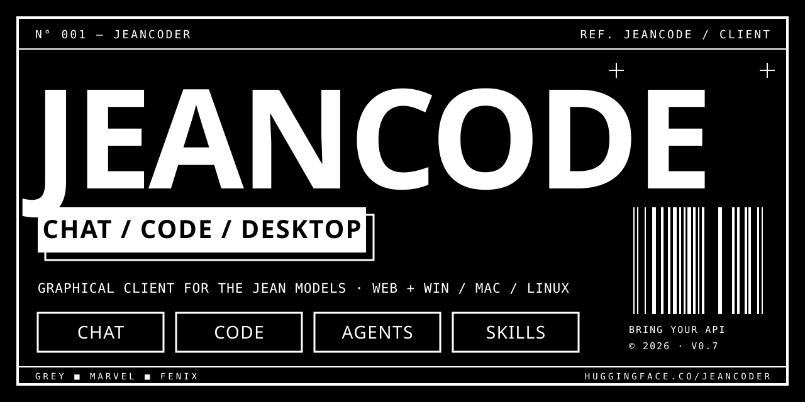

<div align="center">



<br>

[](https://jeancodeeer.github.io/jeancode/)
[](https://github.com/jeancodeeer/jeancode/releases/latest)
[](https://github.com/jeancodeeer/Jean-API-Generator)

[`ENGLISH`](README.md) · **`ESPAÑOL`**

</div>

```
N° 001 — JEANCODE                                                    REF. V0.1
Cliente gráfico de los modelos Jean. Chatea, genera proyectos completos, usa un agente.
Sin servidor, sin cuenta, sin rastreo: trae tu propia Jean-API-Generator.
```

<br>

## 01 — QUÉ ES

**JeanCode** es la interfaz para programadores y vibecoders que prefieren hacer clic antes que escribir en una terminal. Se conecta a **tu propia** [`Jean-API-Generator`](https://github.com/jeancodeeer/Jean-API-Generator): los modelos Jean v0.7 servidos como API compatible con OpenAI desde un Codespace de GitHub.

| MODO | DÓNDE | QUÉ HACE |
|---|---|---|
| **CHAT** | web + escritorio | Conversación en streaming con Markdown, bloques de código con copiar y razonamiento plegable. |
| **CODE** | web + escritorio | Describes un proyecto y Jean escribe todos los archivos. Árbol de archivos, edición, vista previa de páginas web y descarga en `.zip`. No ejecuta nada en tu PC. |
| **AGENT** | solo escritorio | Agente de programación estilo Claude Code: inspecciona la carpeta que elijas, lee, busca y edita archivos, ejecuta comandos con tu permiso, lanza **subagentes** en paralelo y carga **skills**. |

<br>

## 02 — CÓMO SE CONECTA

1. Crea tu API con **[Jean-API-Generator](https://github.com/jeancodeeer/Jean-API-Generator)** (Codespace gratuito).
2. Abre **[JeanCode](https://jeancodeeer.github.io/jeancode/)**. Si este equipo no tiene una API registrada, aparece un splash que pide tu **URL base** (terminada en `/v1`) y tu **API key**. También puede generarte una clave aleatoria segura para usarla como `JEAN_API_KEY`.
3. Agrega los dos puertos (Grey `:8888`, Marvel `:8889`) en **AJUSTES** para ver todos los modelos.

El repositorio **no contiene URLs ni claves**: cada usuario trae las suyas. En el navegador quedan en el almacenamiento local; en el escritorio la clave se cifra con el llavero del sistema (`safeStorage`).

<br>

## 03 — AGENTE DE ESCRITORIO

| | |
|---|---|
| **Carpeta aislada** | Toda ruta se resuelve dentro de la carpeta elegida; se rechazan `..` y enlaces que salgan de ella. |
| **Permisos** | `PREGUNTAR TODO` (por defecto) · `EDITAR SIN PREGUNTAR` (los comandos siguen preguntando) · `SOLO LECTURA`. |
| **Herramientas** | `list_dir` · `read_file` · `search` · `write_file` · `edit_file` · `run_command` · `system_info` · `spawn_subagent` · `load_skill` |
| **Subagentes** | Varios `spawn_subagent` en un mismo turno corren en paralelo, cada uno con su contexto, y devuelven un informe. Solo lectura salvo que el agente pida escritura. |
| **Skills** | Carpetas con `SKILL.md` (`name` + `description`). Se instalan desde una carpeta, un repo git o la URL de un `SKILL.md`. Ver [`skills/`](skills/). |

Los instaladores para **Windows (.exe)**, **macOS (.dmg)** y **Linux (.AppImage)** los compila GitHub Actions en cada [release](https://github.com/jeancodeeer/jeancode/releases). La versión de macOS no está firmada: ábrela la primera vez con clic derecho → Abrir.

<br>

## 04 — DESARROLLO

```bash
python -m http.server 8000 --directory web      # web
cd desktop && npm install && npm start          # escritorio
git tag v0.1.0 && git push origin v0.1.0        # publicar instaladores
```

<br>

## 05 — PRIVACIDAD Y LICENCIA

Página estática: sin backend, sin base de datos, sin analítica. Los mensajes van directo de tu navegador a tu API. Todavía no hay archivo de licencia publicado; por defecto, todos los derechos reservados.

<div align="center">

<br>

```
JEANCODER © 2026 — CHAT ■ CODE ■ AGENT
```

</div>
