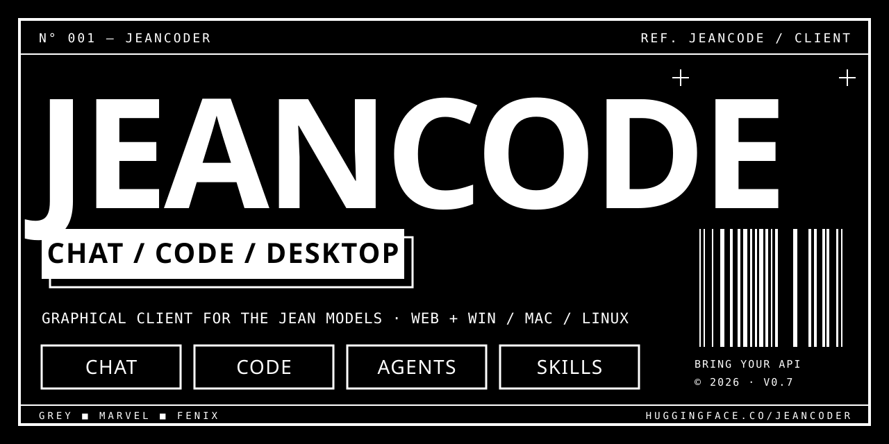
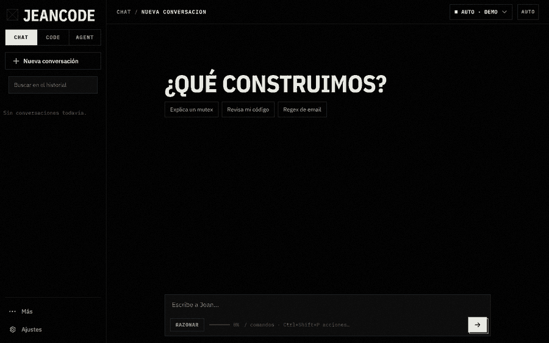
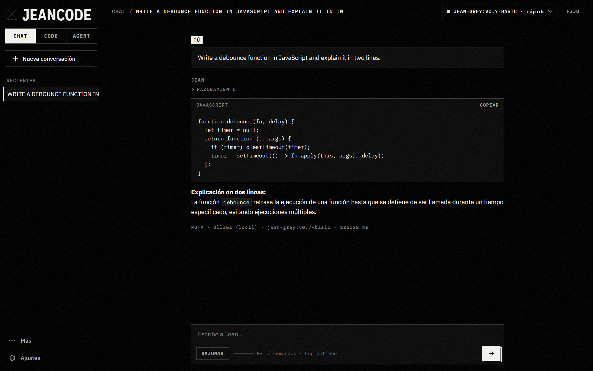

<div align="center">



<br>

# JeanCode — the open-source AI coding agent that brings its own model

**Chat · generate whole projects · run an agent that edits code, runs commands, checks its own errors and can operate your PC.**<br>
Any OpenAI-compatible model: **Ollama, llama.cpp, LM Studio, OpenRouter, NVIDIA NIM, Groq, DeepSeek** and 28 cloud providers — or your own **free** Jean API on Kaggle's free GPUs.

[](https://jeancodeeer.github.io/JeanCode/)
[](https://github.com/jeancodeeer/JeanCode/releases/latest)
[](https://github.com/jeancodeeer/Jean-API-Generator)
[](https://huggingface.co/JeanCoder/jean-models)

**`ENGLISH`** · [`ESPAÑOL`](README.es.md)

</div>

```
N° 001 — JEANCODE                                                     REF. 1.x
No server, no account, no telemetry. Your model, your keys, your machine.
```

<p align="center">
  
  <br><sub>10-second tour of the real desktop app: answer, <b>Regenerate → shorter</b> with versions ‹ 2/2 ›, command palette, MCP apps and skills. Answers come from a demo model so the clip is reproducible.</sub>
</p>

<p align="center">
  
  <br><sub>And a real answer from Jean Grey running locally on Ollama (CPU, no cloud).</sub>
</p>

<br>

## 01 — WHY JEANCODE

- **Bring any model.** 28 cloud providers built in (OpenAI, Anthropic, Gemini, OpenRouter, Groq, NVIDIA NIM, DeepSeek, Mistral, xAI, Together, Fireworks, Cerebras, SambaNova, DeepInfra, Moonshot/Kimi, Z.ai/GLM, Qwen, MiniMax, Cohere and more) plus **Ollama, LM Studio, LiteLLM, llama.cpp, vLLM, Jan, KoboldCpp** on your own PC. Switch models mid-conversation.
- **Free path that actually works.** Point it at [Jean-API-Generator](https://github.com/jeancodeeer/Jean-API-Generator) and you get your own OpenAI-compatible API on your own free Kaggle account, with GPU — no card, no quota from us.
- **A real agent, not a chat box.** Reads, searches and edits your files, runs terminal commands with your permission, launches parallel subagents, loads skills, keeps a task list, and **rewinds** files and conversation to any message.
- **It checks its own work.** After every edit the agent gets the file's syntax errors (JS, JSON, Python, PowerShell, Bash, Go) and fixes them before moving on — like an LSP, without running anything from your repo.
- **It connects to your apps.** Gmail, Drive, Calendar, Docs, Sheets, GitHub, Notion, Linear, Jira, Figma, Supabase and 30 more through **MCP**, the same standard Claude Code uses — one click and you authorize in your browser; every action asks first. [How it works](docs/apps.md).
- **100 skills and Claude Code-style automations.** One-click catalog of 100 open-source skills (Office files, TDD, debugging, React, Python, security, Hugging Face…), hooks that can block or approve actions, scheduled tasks and `/loop`. [Automations](docs/automations.md).
- **It can use your computer** (Windows). Sees the screen, reads window controls, clicks, types, presses shortcuts — with risk-based permissions, a floating STOP bar and `Ctrl+Alt+Q` emergency stop.
- **Nothing hidden.** `/context` shows the exact prompt sent to the model and what each part costs in tokens. `/doctor` checks your whole setup in one go.

<br>

## 01b — WHERE IT FITS, AND WHERE IT DOESN'T

There are excellent coding agents already ([OpenCode](https://github.com/sst/opencode), [Cline](https://github.com/cline/cline), [Claude Code](https://github.com/anthropics/claude-code), [Aider](https://github.com/Aider-AI/aider)). They live in a terminal or inside an editor. JeanCode is the one with **a window of its own and no server in the middle**, so it is built around a different question: *what if the AI you code with answered only to you?*

| IF YOU NEED… | JEANCODE |
|---|---|
| to keep your keys and code off someone else's servers | There is no backend and no telemetry. Keys sit in your OS keychain. A warning stops you before you paste a secret to a remote model. |
| to use whatever model is cheapest or best this week | 28 providers, Ollama, LM Studio and llama.cpp in one picker; switch mid-conversation; automatic fallback when one fails. |
| one tool on your laptop, your phone and a borrowed PC | Desktop (Windows, macOS, Linux), an installable web app and Android/iOS builds share the same interface and history. |
| to see what the model is really being sent | `/context` prints the exact prompt and what each part costs in tokens. |
| to undo an agent that went too far | **Back to here** restores files *and* the conversation to any message. |
| AI that tells you when it doesn't know | Answers are told not to invent sources, links can be checked on demand, and every reply names the model that wrote it. |

**Honest limits**
- The **Agent** and computer control need the desktop app; computer control is **Windows only** and works best with a capable model (small local models can lose the thread on long screen tasks).
- The Android build is signed with a debug key and the iOS build is **unsigned** (install with AltStore or Sideloadly).
- The free [Jean API](https://github.com/jeancodeeer/Jean-API-Generator) runs on your Kaggle account's free T4 GPUs (about 30 hours a week, renewed weekly); a session lasts up to 12 hours and gives a new URL each time. It is a personal server, not a hosted service. For heavier work connect any other API.
- Comparisons above are about where each tool lives, not about which writes better code: that depends on the model you plug in.

## 02 — QUICK START

| YOU HAVE | DO THIS |
|---|---|
| **Ollama / LM Studio** on your PC | Install the [desktop app](https://github.com/jeancodeeer/JeanCode/releases/latest) → **Use this PC's models**. One click, no keys. |
| **An API key** (OpenRouter, Groq, NVIDIA…) | Open [JeanCode web](https://jeancodeeer.github.io/JeanCode/) → pick the provider → paste the key. The URL is filled in for you. |
| **Nothing yet** | Create your free API with [Jean-API-Generator](https://github.com/jeancodeeer/Jean-API-Generator) (open the notebook in your Kaggle, Run All, ~5 min), then paste the URL it prints. |

| PLATFORM | GET IT | MODES |
|---|---|---|
| **Web** (any phone or computer) | [jeancodeeer.github.io/JeanCode](https://jeancodeeer.github.io/JeanCode/) — installable PWA, works offline | CHAT · CODE |
| **Android** | `JeanCode-x.y.z-android.apk` from the [latest release](https://github.com/jeancodeeer/JeanCode/releases/latest) | CHAT |
| **iOS / iPadOS** | `JeanCode-x.y.z-ios-unsigned.ipa` — install with [AltStore](https://altstore.io) or [Sideloadly](https://sideloadly.io) using your own Apple ID | CHAT |
| **Python + pygame** (any OS, and PyKernel) | `JeanCode-x.y.z-pygame.zip` from the [latest release](https://github.com/jeancodeeer/JeanCode/releases/latest) → `pip install pygame-ce` → `python jeancode_pygame.py`. See [pygame/README.md](pygame/README.md) | CHAT |
| **Windows · macOS · Linux** | `.exe` · `.dmg` · `.AppImage` from the [latest release](https://github.com/jeancodeeer/JeanCode/releases/latest) | CHAT · **AGENT** · computer control |

The phone apps are the same web app compiled with Capacitor. The Android APK is signed with a debug key (allow "install unknown apps"); the iOS build is unsigned because App Store distribution needs a paid Apple developer account.

<br>

## 02b — HOW TO INSTALL IT ON EACH DEVICE

Everything is downloaded from the [latest release](https://github.com/jeancodeeer/JeanCode/releases/latest) (`x.y.z` is the version). No version asks for an account: only your API's URL and key.

<details open>
<summary><b>Web (any browser)</b></summary>

Open [jeancodeeer.github.io/JeanCode](https://jeancodeeer.github.io/JeanCode/). Nothing to install. To keep it as an app (works offline):
- **Chrome / Edge on a PC or Android**: ⋮ menu → **Install JeanCode** (or the install icon in the address bar).
- **Safari on iPhone / iPad**: Share button → **Add to Home Screen**.

Offline you can also use `JeanCode-x.y.z-web.zip`: unzip it and serve the folder with `python -m http.server 8000`.
</details>

<details>
<summary><b>Android</b></summary>

1. Download `JeanCode-x.y.z-android.apk` on the phone.
2. Open it. Android asks to allow **installing unknown apps** from the browser or file manager: allow it for that app only.
3. Tap **Install**. To update, install the new APK on top (your data stays).

It is signed with a debug key, so Play Protect may warn; the app is the same web build wrapped with Capacitor.
</details>

<details>
<summary><b>iPhone / iPad</b></summary>

`JeanCode-x.y.z-ios-unsigned.ipa` is unsigned (the App Store needs a paid Apple developer account). Install it with your own Apple ID:
1. Install [AltStore](https://altstore.io) or [Sideloadly](https://sideloadly.io) on your PC or Mac and plug in the iPhone.
2. Drop the `.ipa` in and sign in with your Apple ID.
3. On the iPhone: **Settings → General → VPN & Device Management** → trust your Apple ID. On iOS 16+, also turn on **Developer Mode** (Settings → Privacy & Security).

With a free Apple ID the app expires after 7 days: reinstall it (AltStore refreshes it for you). Rather not? Use the web app from Safari.
</details>

<details>
<summary><b>Windows</b></summary>

1. Download `JeanCode-x.y.z-win-x64.exe` and run it.
2. If SmartScreen says "Windows protected your PC" (the installer has no paid signature): **More info → Run anyway**.
3. Pick a folder and finish. It shows up in the Start menu. New versions install on top.
</details>

<details>
<summary><b>macOS</b></summary>

1. Download the `.dmg` for your Mac: `mac-arm64` for Apple Silicon (M1, M2…), `mac-x64` for Intel.
2. Open it and drag **JeanCode** to **Applications**.
3. The first time, macOS blocks it because it is not notarized: right-click JeanCode → **Open** → **Open**. If that option is missing: **System Settings → Privacy & Security → Open Anyway**, or in Terminal `xattr -dr com.apple.quarantine /Applications/JeanCode.app`.
</details>

<details>
<summary><b>Linux</b></summary>

```bash
chmod +x JeanCode-x.y.z-linux-x86_64.AppImage
./JeanCode-x.y.z-linux-x86_64.AppImage
```
If it complains about FUSE: `sudo apt install libfuse2` (`libfuse2t64` on Ubuntu 24.04+).
</details>

<details>
<summary><b>Python + pygame (any system with Python 3.8+)</b></summary>

A light chat client in a window: good for old PCs, a Raspberry Pi or a machine without a browser.
```bash
pip install pygame-ce
python jeancode_pygame.py          # inside the folder of JeanCode-x.y.z-pygame.zip
```
F2 API and key · F3 model · F4 history · Esc stops · Ctrl+Q quits. More in [pygame/README.md](pygame/README.md).
</details>

<details>
<summary><b>PyKernel</b></summary>

[PyKernel](pygame/README.md#dentro-de-pykernel) is an x86_64 kernel whose operating system is Python (MicroPython): it boots straight into `>>>`. The pygame client runs inside it unchanged.

**If your PyKernel already has it** (`/lib/jeancode`):
```bash
python tools/run.py --screen        # on the PC: opens the machine in a window plus the network bridge
```
```
>>> jeancode
```

**If it doesn't**, copy it to its (FAT) disk with mtools, on Linux or WSL, with the machine off:
```bash
unzip JeanCode-x.y.z-pygame.zip
mmd   -i build/disk.img ::/lib                                   # if /lib does not exist on the disk yet
mcopy -i build/disk.img -s JeanCode-x.y.z-pygame/jeancode ::/lib/
```
Modules in `/disk/lib` are importable. Inside PyKernel:
```
>>> from jeancode import app; app.main()
```

**Networking:** PyKernel has no network card or TCP/IP yet. JeanCode sends each request through the **second serial port (COM2)** and `bridge.py`, on the host PC, makes the HTTPS call. `tools/run.py` sets it up; with plain QEMU:
```bash
qemu-system-x86_64 ... -serial vc -serial tcp:127.0.0.1:4555,server=on,wait=off
python bridge.py --connect 127.0.0.1:4555                        # in another terminal
```
To see the window QEMU needs a graphical display (in WSL: `sudo apt install qemu-system-gui`). Settings and history live in `/disk/jeancode/`. Inside PyKernel, `localhost` is the PC running the bridge (handy for Ollama or LM Studio).
</details>

<br>

## 03 — THREE MODES

<table>
<tr>
<td width="33%" valign="top"><b>CHAT</b> · web + desktop<br>Streaming Markdown, code blocks, collapsible reasoning, per-answer token usage.</td>
<td width="33%" valign="top"><b>CODE</b> · web<br>Describe a project; every file is written for you. File tree, <b>RUN</b> the whole project (HTML with its JS/CSS, Python, JavaScript, Batch… sandboxed; on desktop, any installed language, with your permission), download as <code>.zip</code>.</td>
<td width="33%" valign="top"><b>AGENT</b> · desktop<br>A coding agent in the style of Claude Code and OpenCode, working inside the folder you choose.</td>
</tr>
</table>

<br>

## 04 — THE AGENT

| | |
|---|---|
| **Tools** | `list_dir` · `glob` · `read_file` · `search` · `diagnostics` · `webfetch` · `write_file` · `edit_file` · `move_file` · `delete_file` (to the recycle bin) · `run_command` · `start_process` / `process_output` / `stop_process` (dev servers) · `todo_write` · `spawn_subagent` · `load_skill` |
| **BUILD / PLAN** | `BUILD` implements; `PLAN` only investigates and proposes. `Tab` switches. After a plan: **Approve and run in BUILD**. |
| **Permissions** | `ASK EVERYTHING` · `EDIT WITHOUT ASKING` · `READ ONLY`. Every edit shows a diff first. **Allow always here** per folder and exact command; destructive commands ask every time anyway. |
| **Rewind** | **Back to here** on every message. In git folders the checkpoint covers the whole working tree, so files changed by commands come back too. |
| **Self-check** | Syntax diagnostics after every write. `diagnostics` with `deep` adds the project's own TypeScript, ESLint and `tsc` — with your permission, because that runs code from the repo. |
| **Subagents** | Several `spawn_subagent` calls run in parallel with their own context; each reports steps, tools used, errors, tokens and time. Project subagents in `.jeancode/agents/*.md`. |
| **Skills** | Folders with a `SKILL.md`. Install from a folder, a git repo or a URL. See [`skills/`](skills/). |
| **Project memory** | `AGENTS.md`, `JEANCODE.md` or `CLAUDE.md` loaded every session; `/init` writes one. **Pinned rules** survive compaction. |
| **Hooks** | `.jeancode/hooks.json` (`post_edit`, `post_turn`), trusted once per change. |
| **Context** | The meter uses the model's **real** window (reported by the provider, the router or llama-server). At 85 % it asks before compacting and shows the summary. |

**Commands:** `/new` `/clear` `/compact` `/context` `/doctor` `/model <id>` `/export` `/help` · CODE: `/zip` · AGENT: `/init` `/plan` `/build` `/undo` `/review` · plus your own `.jeancode/commands/<name>.md`.
**Keys:** `Esc` stop · `Ctrl+K` new · `Ctrl+1/2/3` mode · `Tab` BUILD↔PLAN · `@` attach a file.

<br>

## 05 — COMPUTER CONTROL (WINDOWS)

Turn it on in **Settings → Computer** and the agent can operate your desktop: screenshot, read the controls of any window (UI Automation, so it works even with models without vision), move and click the mouse, drag, scroll, type, press shortcuts, focus windows and open apps — in an observe → act → verify loop.

| RISK | EXAMPLES | DEFAULT |
|---|---|---|
| **Low** | read the screen, click, type into a normal app | allowed |
| **Medium** | shortcuts, opening apps, text with Enter | asked once per exact action |
| **High** | anything in a terminal, opening shells, `Win` / `Alt+F4` | **always asked** |

It never types into password fields, never acts on JeanCode's own window, logs every action without the typed text, and stops instantly from the floating bar or `Ctrl+Alt+Q`. Details and honest limits (admin windows, UAC, primary monitor only) in [docs/computer-control.md](docs/computer-control.md). macOS and Linux: not yet.

<br>

## 06 — WHAT IT DOES DIFFERENTLY

Built from the most common complaints about Claude Code and OpenCode (issue trackers, forums, reviews):

| PROBLEM ELSEWHERE | JEANCODE |
|---|---|
| Locked to one vendor's models | 28 cloud providers + local servers + your own free API; switch mid-session. |
| Compaction is opaque and drops instructions | Never silent: asks at 85 %, shows the summary; pinned rules and project memory are sent every turn. |
| Context meter assumes one window size | Uses each model's real window; `/compact` sizes the transcript to it. |
| Unpredictable cost | Tokens under every answer, session total, cost when the provider publishes prices. |
| "What is it actually sending?" | `/context` prints the exact system prompt and the weight of every part. |
| Setup errors with unclear causes | `/doctor` checks connections, model, window, folder, memory, hooks and skills, with the fix for each. |
| Checkpoints miss shell changes / no checkpoints at all | **Back to here** restores files *and* conversation; in git, the whole working tree. |
| Permission fatigue | Allow always per folder and exact command, editable; destructive commands still ask. |
| No LSP feedback | Syntax diagnostics after every edit, deep checks on demand. |
| Opaque subagents | Per-subagent trace: steps, tools, errors, tokens, time. |
| UI loaded from a CDN, telemetry | Everything ships with the app. No analytics, no backend, no requests to Google. |

<br>

## 07 — HOW IT CONNECTS

```
┌──────────────┐   your URL + your key   ┌──────────────────────────────────────┐
│  JEANCODE    │ ──────────────────────▶ │ Ollama · LM Studio · llama.cpp       │
│  web / app   │ ◀────── streaming ───── │ OpenRouter · NVIDIA NIM · Groq · …   │
└──────────────┘                          │ or YOUR Jean-API-Generator (free)    │
                                          └──────────────────────────────────────┘
```

Every connection is validated before use (bad URL, http from an https page, key in the URL, duplicates, wrong provider for that host — fixed for you). **AUTO** picks a model per mode and skips connections that are down; you choose what happens when a model fails (show the error, same model elsewhere, or any other model). Each answer carries its route, without keys. **Hugging Face** in the side menu loads any GGUF from the Hub into your Codespace with a progress bar.

**APIs that block browsers (CORS).** Some providers (NVIDIA NIM, SambaNova, Z.ai) refuse calls from web pages (checked live on 2026-11-14). JeanCode handles it without any third-party server: on the web it sends those calls through the **relay of your own Jean-API-Generator** (`/relay/` on its router, streaming kept, only to a fixed list of known providers); in the phone apps it falls back to the phone's native networking when there is no relay. An unknown provider that fails from the browser is detected and remembered. The desktop app is never affected.

The repository contains **no URLs and no keys**. In the browser they stay in local storage; in the desktop app the key is encrypted with the OS keychain.

<br>

## 08 — RUN IT FROM SOURCE

```bash
python -m http.server 8000 --directory web        # web: any static server
cd desktop && npm install && npm start            # desktop (Electron)
node --test tests/unit.test.mjs                   # unit tests
python pygame/jeancode_pygame.py                  # pygame client (pip install pygame-ce)
python -m unittest discover -s pygame/tests       # its tests
node --test --test-concurrency=1 tests/computer/control.test.mjs   # real computer-control tests (Windows)
```

```
web/        plain HTML/CSS/ES modules, no build step (GitHub Pages + PWA)
mobile/     Capacitor wrapper of web/ for iOS and Android (cd mobile && npm install && npm run android|ios)
desktop/    Electron; reuses web/ as its UI · lib/ = files, terminal, diagnostics, computer control
pygame/     Python + pygame client: the same code on CPython and on PyKernel (MicroPython)
skills/     example skills        docs/     computer control, screenshots
```

Releases: `node scripts/version.mjs X.Y.Z`, tag `vX.Y.Z` — GitHub Actions builds Windows, macOS (Intel + Apple Silicon) and Linux installers plus the web `.zip`. History: [CHANGELOG.md](CHANGELOG.md).

<br>

## 09 — PRIVACY · SECURITY

No backend, no database, no analytics. Messages go straight from your device to the API you chose. The agent works only inside the folder you pick (`..` and escaping symlinks are rejected), text it reads from the screen is scrubbed of keys and tokens before it reaches a model, and it never runs your repo's own tooling without asking. Report issues: [SECURITY.md](SECURITY.md).

<br>

## 10 — LICENSE

[MIT](LICENSE). Use it, change it, ship it, in personal or commercial projects; just keep the copyright notice.

<div align="center">

<br>

If JeanCode saves you a subscription, a ⭐ helps other people find it.

```
JEANCODER © 2026 — CHAT ■ CODE ■ AGENT
```

</div>
