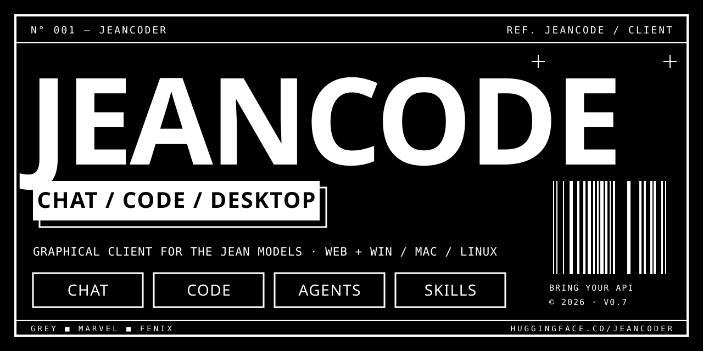
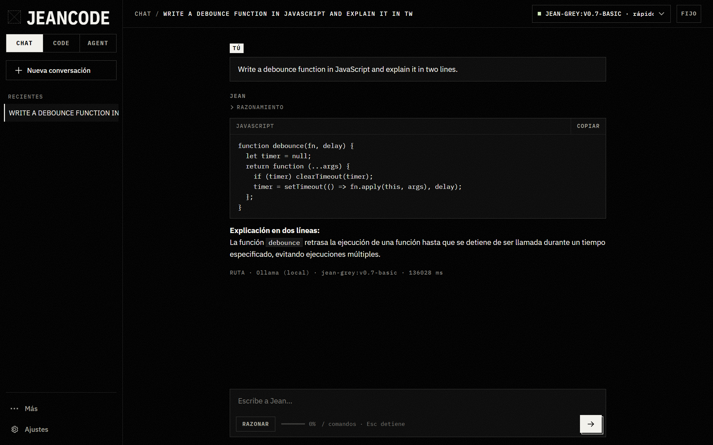

<div align="center">



<br>

# JeanCode — the open-source AI coding agent that brings its own model

**Chat · generate whole projects · run an agent that edits code, runs commands, checks its own errors and can operate your PC.**<br>
Any OpenAI-compatible model: **Ollama, llama.cpp, LM Studio, OpenRouter, NVIDIA NIM, Groq, DeepSeek** and 28 cloud providers — or your own **free** Jean API on GitHub Codespaces.

[](https://jeancodeeer.github.io/JeanCode/)
[](https://github.com/jeancodeeer/JeanCode/releases/latest)
[](https://github.com/jeancodeeer/Jean-API-Generator)
[](https://huggingface.co/JeanCoder/jean-models)

**`ENGLISH`** · [`ESPAÑOL`](README.es.md)

</div>

```
N° 001 — JEANCODE                                                     REF. 1.x
No server, no account, no telemetry. Your model, your keys, your machine.
```

<p align="center">
  
  <br><sub>Chat mode — real answer from Jean Grey running locally on Ollama (CPU, no cloud).</sub>
</p>

<br>

## 01 — WHY JEANCODE

- **Bring any model.** 28 cloud providers built in (OpenAI, Anthropic, Gemini, OpenRouter, Groq, NVIDIA NIM, DeepSeek, Mistral, xAI, Together, Fireworks, Cerebras, SambaNova, DeepInfra, Moonshot/Kimi, Z.ai/GLM, Qwen, MiniMax, Cohere and more) plus **Ollama, LM Studio, LiteLLM, llama.cpp, vLLM, Jan, KoboldCpp** on your own PC. Switch models mid-conversation.
- **Free path that actually works.** Point it at [Jean-API-Generator](https://github.com/jeancodeeer/Jean-API-Generator) and you get your own OpenAI-compatible API on a free GitHub Codespace — no card, no quota from us.
- **A real agent, not a chat box.** Reads, searches and edits your files, runs terminal commands with your permission, launches parallel subagents, loads skills, keeps a task list, and **rewinds** files and conversation to any message.
- **It checks its own work.** After every edit the agent gets the file's syntax errors (JS, JSON, Python, PowerShell, Bash, Go) and fixes them before moving on — like an LSP, without running anything from your repo.
- **It can use your computer** (Windows). Sees the screen, reads window controls, clicks, types, presses shortcuts — with risk-based permissions, a floating STOP bar and `Ctrl+Alt+Q` emergency stop.
- **Nothing hidden.** `/context` shows the exact prompt sent to the model and what each part costs in tokens. `/doctor` checks your whole setup in one go.

<br>

## 02 — QUICK START

| YOU HAVE | DO THIS |
|---|---|
| **Ollama / LM Studio** on your PC | Install the [desktop app](https://github.com/jeancodeeer/JeanCode/releases/latest) → **Use this PC's models**. One click, no keys. |
| **An API key** (OpenRouter, Groq, NVIDIA…) | Open [JeanCode web](https://jeancodeeer.github.io/JeanCode/) → pick the provider → paste the key. The URL is filled in for you. |
| **Nothing yet** | Create your free API with [Jean-API-Generator](https://github.com/jeancodeeer/Jean-API-Generator) (one Codespace, ~5 min), then paste its `…-8899.app.github.dev/v1` URL. |

The web version is an installable PWA that works offline. The **AGENT** mode and computer control need the desktop app (Windows `.exe`, macOS `.dmg`, Linux `.AppImage`).

<br>

## 03 — THREE MODES

<table>
<tr>
<td width="33%" valign="top"><b>CHAT</b> · web + desktop<br>Streaming Markdown, code blocks, collapsible reasoning, per-answer token usage.</td>
<td width="33%" valign="top"><b>CODE</b> · web + desktop<br>Describe a project; every file is written for you. File tree, live preview, download as <code>.zip</code>. Nothing runs on your machine.</td>
<td width="33%" valign="top"><b>AGENT</b> · desktop<br>A coding agent in the style of Claude Code and OpenCode, working inside the folder you choose.</td>
</tr>
</table>

<br>

## 04 — THE AGENT

| | |
|---|---|
| **Tools** | `list_dir` · `glob` · `read_file` · `search` · `diagnostics` · `webfetch` · `write_file` · `edit_file` · `move_file` · `delete_file` (to the recycle bin) · `run_command` · `start_process` / `process_output` / `stop_process` (dev servers) · `todo_write` · `spawn_subagent` · `load_skill` |
| **BUILD / PLAN** | `BUILD` implements; `PLAN` only investigates and proposes. `Tab` switches. After a plan: **Approve and run in BUILD**. |
| **Permissions** | `ASK EVERYTHING` · `EDIT WITHOUT ASKING` · `READ ONLY`. Every edit shows a diff first. **Allow always here** per folder and exact command; destructive commands ask every time anyway. |
| **Rewind** | **Back to here** on every message. In git folders the checkpoint covers the whole working tree, so files changed by commands come back too. |
| **Self-check** | Syntax diagnostics after every write. `diagnostics` with `deep` adds the project's own TypeScript, ESLint and `tsc` — with your permission, because that runs code from the repo. |
| **Subagents** | Several `spawn_subagent` calls run in parallel with their own context; each reports steps, tools used, errors, tokens and time. Project subagents in `.jeancode/agents/*.md`. |
| **Skills** | Folders with a `SKILL.md`. Install from a folder, a git repo or a URL. See [`skills/`](skills/). |
| **Project memory** | `AGENTS.md`, `JEANCODE.md` or `CLAUDE.md` loaded every session; `/init` writes one. **Pinned rules** survive compaction. |
| **Hooks** | `.jeancode/hooks.json` (`post_edit`, `post_turn`), trusted once per change. |
| **Context** | The meter uses the model's **real** window (reported by the provider, the router or llama-server). At 85 % it asks before compacting and shows the summary. |

**Commands:** `/new` `/clear` `/compact` `/context` `/doctor` `/model <id>` `/export` `/help` · CODE: `/zip` · AGENT: `/init` `/plan` `/build` `/undo` `/review` · plus your own `.jeancode/commands/<name>.md`.
**Keys:** `Esc` stop · `Ctrl+K` new · `Ctrl+1/2/3` mode · `Tab` BUILD↔PLAN · `@` attach a file.

<br>

## 05 — COMPUTER CONTROL (WINDOWS)

Turn it on in **Settings → Computer** and the agent can operate your desktop: screenshot, read the controls of any window (UI Automation, so it works even with models without vision), move and click the mouse, drag, scroll, type, press shortcuts, focus windows and open apps — in an observe → act → verify loop.

| RISK | EXAMPLES | DEFAULT |
|---|---|---|
| **Low** | read the screen, click, type into a normal app | allowed |
| **Medium** | shortcuts, opening apps, text with Enter | asked once per exact action |
| **High** | anything in a terminal, opening shells, `Win` / `Alt+F4` | **always asked** |

It never types into password fields, never acts on JeanCode's own window, logs every action without the typed text, and stops instantly from the floating bar or `Ctrl+Alt+Q`. Details and honest limits (admin windows, UAC, primary monitor only) in [docs/computer-control.md](docs/computer-control.md). macOS and Linux: not yet.

<br>

## 06 — WHAT IT DOES DIFFERENTLY

Built from the most common complaints about Claude Code and OpenCode (issue trackers, forums, reviews):

| PROBLEM ELSEWHERE | JEANCODE |
|---|---|
| Locked to one vendor's models | 28 cloud providers + local servers + your own free API; switch mid-session. |
| Compaction is opaque and drops instructions | Never silent: asks at 85 %, shows the summary; pinned rules and project memory are sent every turn. |
| Context meter assumes one window size | Uses each model's real window; `/compact` sizes the transcript to it. |
| Unpredictable cost | Tokens under every answer, session total, cost when the provider publishes prices. |
| "What is it actually sending?" | `/context` prints the exact system prompt and the weight of every part. |
| Setup errors with unclear causes | `/doctor` checks connections, model, window, folder, memory, hooks and skills, with the fix for each. |
| Checkpoints miss shell changes / no checkpoints at all | **Back to here** restores files *and* conversation; in git, the whole working tree. |
| Permission fatigue | Allow always per folder and exact command, editable; destructive commands still ask. |
| No LSP feedback | Syntax diagnostics after every edit, deep checks on demand. |
| Opaque subagents | Per-subagent trace: steps, tools, errors, tokens, time. |
| UI loaded from a CDN, telemetry | Everything ships with the app. No analytics, no backend, no requests to Google. |

<br>

## 07 — HOW IT CONNECTS

```
┌──────────────┐   your URL + your key   ┌──────────────────────────────────────┐
│  JEANCODE    │ ──────────────────────▶ │ Ollama · LM Studio · llama.cpp       │
│  web / app   │ ◀────── streaming ───── │ OpenRouter · NVIDIA NIM · Groq · …   │
└──────────────┘                          │ or YOUR Jean-API-Generator (free)    │
                                          └──────────────────────────────────────┘
```

Every connection is validated before use (bad URL, http from an https page, key in the URL, duplicates, wrong provider for that host — fixed for you). **AUTO** picks a model per mode and skips connections that are down; you choose what happens when a model fails (show the error, same model elsewhere, or any other model). Each answer carries its route, without keys. **Hugging Face** in the side menu loads any GGUF from the Hub into your Codespace with a progress bar.

The repository contains **no URLs and no keys**. In the browser they stay in local storage; in the desktop app the key is encrypted with the OS keychain.

<br>

## 08 — RUN IT FROM SOURCE

```bash
python -m http.server 8000 --directory web        # web: any static server
cd desktop && npm install && npm start            # desktop (Electron)
node --test tests/unit.test.mjs                   # unit tests
node --test --test-concurrency=1 tests/computer/control.test.mjs   # real computer-control tests (Windows)
```

```
web/        plain HTML/CSS/ES modules, no build step (GitHub Pages + PWA)
desktop/    Electron; reuses web/ as its UI · lib/ = files, terminal, diagnostics, computer control
skills/     example skills        docs/     computer control, screenshots
```

Releases: `node scripts/version.mjs X.Y.Z`, tag `vX.Y.Z` — GitHub Actions builds Windows, macOS (Intel + Apple Silicon) and Linux installers plus the web `.zip`. History: [CHANGELOG.md](CHANGELOG.md).

<br>

## 09 — PRIVACY · SECURITY

No backend, no database, no analytics. Messages go straight from your device to the API you chose. The agent works only inside the folder you pick (`..` and escaping symlinks are rejected), text it reads from the screen is scrubbed of keys and tokens before it reaches a model, and it never runs your repo's own tooling without asking. Report issues: [SECURITY.md](SECURITY.md).

<br>

## 10 — LICENSE

[GNU AGPL-3.0](LICENSE). Free to use, study, modify and share. If you distribute a modified version, or run one as a network service, you must publish its source under the same license.

<div align="center">

<br>

If JeanCode saves you a subscription, a ⭐ helps other people find it.

```
JEANCODER © 2026 — CHAT ■ CODE ■ AGENT
```

</div>
