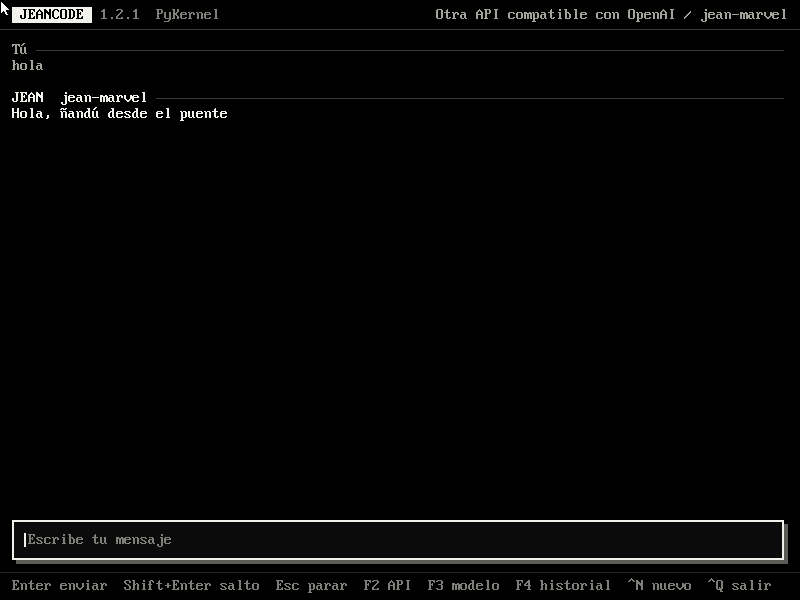

# JeanCode para Python + pygame

El chat de JeanCode en una ventana de pygame. El mismo código corre en CPython (Windows, macOS, Linux) y dentro de **PyKernel**, el kernel x86_64 cuyo sistema operativo es Python (MicroPython).



## En tu PC

```bash
pip install pygame-ce            # o pygame 2
python jeancode_pygame.py
```

1. **F2**: elige el proveedor con ← →, pega la URL (se completa sola salvo en Jean y "Otra API") y la clave.
2. **F3**: elige el modelo de la lista que da la API.
3. Escribe y pulsa **Enter**. La respuesta llega en streaming.

| TECLA | QUÉ HACE |
|---|---|
| Enter / Shift+Enter | enviar / salto de línea |
| Esc | detener la respuesta |
| F2 / F3 / F4 | API y clave / modelo / historial |
| Ctrl+N | conversación nueva |
| Ctrl+V | pegar (en CPython) |
| PgUp / PgDn, rueda | desplazar la conversación |
| Ctrl+Q | salir |

¿No tienes API? [Jean-API-Generator](https://github.com/jeancodeeer/Jean-API-Generator) te da una gratis en Kaggle: proveedor **Jean-API-Generator**, pega la URL `https://….trycloudflare.com/v1` que imprime el notebook y su clave.

Los ajustes y el historial se guardan en `~/.jeancode/pygame/` (o en la carpeta que indique `JEANCODE_HOME`). **La clave se guarda ahí en texto plano**: solo en tu equipo, nunca se envía a otro sitio que no sea la API que elegiste.

## Dentro de PyKernel

PyKernel trae JeanCode en `/lib/jeancode`. En su consola:

```
>>> jeancode
```

PyKernel todavía **no tiene tarjeta de red ni TCP/IP**, así que JeanCode envía cada petición por el **segundo puerto serie (COM2)** a `bridge.py`, que corre en el PC anfitrión y hace la conexión HTTPS. `python tools/run.py --screen` de PyKernel abre la ventana y arranca el puente solo. A mano, con QEMU:

```bash
qemu-system-x86_64 ... -serial vc -serial tcp:127.0.0.1:4555,server=on,wait=off
python bridge.py --connect 127.0.0.1:4555
```

Para instalarlo en otro PyKernel, copia la carpeta `jeancode/` a `/disk/lib/jeancode` (los módulos de `/disk/lib` se importan solos) y ejecuta `from jeancode import app; app.main()`.

En PyKernel: la letra es la fuente VGA de 8×16 (caracteres fuera de CP437, como los emojis, salen como `?`), no hay portapapeles y los datos se guardan en `/disk/jeancode/`.

## Cómo está hecho

```
jeancode_pygame.py   arranque en CPython
bridge.py            puente de red para PyKernel (solo CPython)
jeancode/app.py      la interfaz: chat, ajustes, modelos, historial
jeancode/chat.py     peticiones y respuestas (formato OpenAI, streaming SSE), sin red ni pantalla
jeancode/net.py      red: urllib en CPython; COM2 + puente en PyKernel
jeancode/providers.py  los mismos proveedores que la web
jeancode/store.py    ajustes e historial en JSON
tests/test_core.py   pruebas con una API falsa, el puente y la ventana real (SDL_VIDEODRIVER=dummy)
```

Todo el código evita lo que MicroPython no tiene (`os.path`, `textwrap`, `threading`…), así que no hace falta una versión aparte para PyKernel. Todos los proveedores se usan por su capa compatible con OpenAI (`/chat/completions` y `/models`).

Protocolo del puente, una línea JSON por mensaje:

```
kernel -> puente   {"t":"ping","id":0}   {"t":"req","id":N,"method","url","headers","body"}   {"t":"cancel","id":N}
puente -> kernel   {"t":"pong"}  {"t":"status","status":200}  {"t":"line","d":"..."}  {"t":"end"}  {"t":"error","d":"..."}
```

El puente solo acepta URLs `http://` y `https://` y nunca escribe en su registro las cabeceras ni el cuerpo (llevan la clave).
